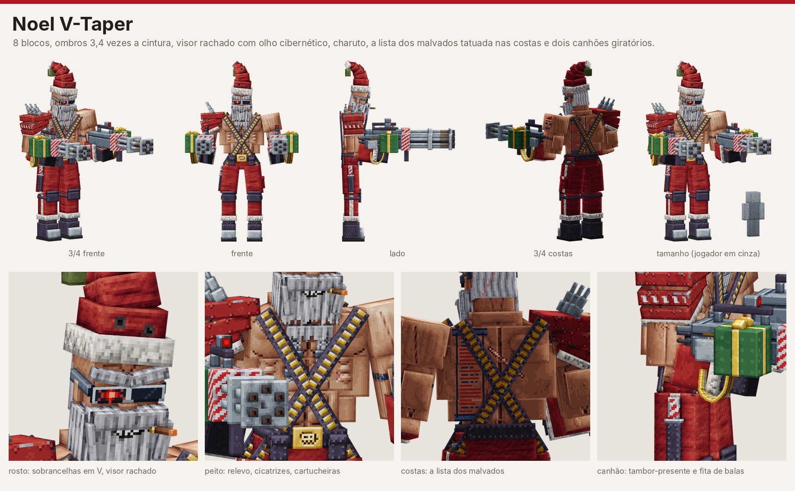

# Bosses de Natal: esboços

Papai Noel chefe para o Natal do TEOF. São esboços: modelo, textura e pose parada, sem animações.

## Noel V-Taper (versão 2, a atual)



`noel_vtaper`: cerca de 8 blocos até a ponta do gorro (quatro jogadores), ombros 3,4 vezes mais largos que a
cintura, trapézio subindo até o pescoço, cabeça baixa.

* **Rosto:** sobrancelhas em V (dois cubos inclinados), visor tático com a lente direita rachada e um olho cibernético
  vermelho, cicatriz cortando a sobrancelha, rosnado com dentes, charuto aceso, bigode de guidão, barba penteada e
  trançada com anéis de aço; cabeça raspada com o cabelo branco só atrás.
* **Corpo:** peitoral, oito gomos, serrátil, oblíquos, dorsais e coluna em relevo; cicatriz de corte no peito e marcas de
  bala; caveira de gorro tatuada no ombro esquerdo, arame farpado no bíceps e a lista dos malvados nas costas, com
  nomes riscados em vermelho; duas cartucheiras em X, na frente e atrás.
* **Equipamento:** ombreira de três lâminas com espinhos e marcas de abates, braçadeiras vermelhas com pelo, luvas sem
  dedos, cinto com fivela de caveira, bolsas e granada, faca de bengala doce, bolso de carga, joelheiras, coturnos com
  biqueira de aço e cadarço, gorro furado de bala com uma granada pendurada na ponta.
* **Armas:** um canhão giratório de sete canos em cada mão: canos azulados pelo calor e com fuligem na boca, luva de
  bengala doce, "HO HO HO" gravado em ouro, mira de ponto vermelho, tambor de munição embrulhado de presente e a fita
  de balas caindo em U até a entrada.

Ossos próprios: `ombreira`, `espinho_0..2`, `granada` (pendurada, desfaz a rotação do gorro), `metralhadora_d/e`
(niveladas com o mundo, filhas de `mao_d/e`), `granada_cinto`, `canela_d/e`.

### Texturas (motor novo, `gerador/pintura.py` e `gerador/materiais.py`)

* Textura com o **dobro da densidade** (512×1024 numa grade UV de 256×512, ou seja, 2 pixels por unidade).
* **Luz embutida:** bordas arredondadas por cubo, relevo por mapa de altura (músculos, trama do tecido, tufos de pelo,
  mechas penteadas, rebites, gravações) e escurecimento nos sulcos.
* **Oclusão ambiente calculada:** raios contra os outros cubos do modelo na pose (sombra sob a barba, o gorro e os
  braços), mais rampas de cor feitas à mão (sombra fria, luz quente).
* O Blockbench web abre o `.bbmodel` com a textura 512×1024 no lugar certo (conferido).
* **A verificar:** a oclusão foi calculada nesta pose, então numa animação com os braços muito longe dela a sombra fica
  onde estava. Também falta ver no jogo se o GeckoLib do Kunftig respeita a textura com o dobro da resolução: ele
  normaliza pela `texture_width` do `.geo.json`, que é 256, e deveria funcionar. A fita de balas está presa ao
  `metralhadora_*` e acompanha a arma.

## V-Taper versão 1 (substituída)

A primeira versão (cubos maiores, textura de 1 pixel por unidade) está no histórico do git.

## Primeira rodada (descartada)


| Boss | Ideia | Altura (escala 1) |
|---|---|---|
| **Noel Brutamontes** (`noel_brutamontes`) | O lutador: casaco aberto, punhos enormes com socos-ingleses de ouro, saco de carvão nas costas, granada-presente no cinto | 4,2 blocos |
| **Noel Sombrio** (`noel_sombrio`) | O corrompido: chifres furando o gorro, olhos que brilham, correntes com sinos, foice de bengala doce, saco de carvão em brasa preso por corrente | 4,6 blocos |
| **Noel do Gelo Eterno** (`noel_gelo_eterno`) | O gigante congelado: coroa de gelo, barba de pingentes, cristais nos ombros, martelo com cabeça de presente congelado, orbe de gelo | 4,4 blocos |

As folhas de cada um (frente, lado, costas e o tamanho ao lado de um jogador) estão em `previas/*_folha.png`.

## Arquivos

* `modelos/<id>.bbmodel`: projeto do Blockbench (formato *Bedrock Entity*, box UV, textura embutida). Abre direto no
  Blockbench (desktop ou web.blockbench.net); conferido no Blockbench web: os três abrem como nas prévias.
* `modelos/<id>.geo.json` + `modelos/<id>.png`: o mesmo modelo exportado para o GeckoLib, o que as exibições do Kunftig
  (`KunftigDisplays`) leem. O `.geo.json` também foi importado no Blockbench e sai igual ao `.bbmodel`.
* `visualizador.html`: os três num visualizador 3D (three.js), para girar no navegador.
* `gerador/`: o código que monta tudo. Os modelos são feitos em Python (`bbtool.py`, um bloco por boss em
  `brutamontes.py`, `sombrio.py`, `gelo.py`) e as prévias são desenhadas com three.js num Chromium headless.

Não havia Blender no ambiente em que foram feitos; o Blockbench é o caminho natural para o GeckoLib, e de lá dá para
exportar `.gltf`/`.obj` para o Blender se precisar.

## Ossos

Os ossos já têm nomes e pivôs pensados para animar depois: `raiz`, `corpo`, `cabeca`, `gorro*`, `braco_d/e`,
`antebraco_d/e`, `punho_d/e` ou `mao_d/e`, `perna_d/e`, e os de cada um (`saco`, `foice`, `lamina*`, `chifre*`,
`capa`, `martelo`, `cabeca_martelo`, `orbe`). `_d` é o lado direito do personagem (+X no Blockbench).

Foram feitos em tamanho de 4 a 5 blocos; no manifesto de exibição dá para aumentar com `"escala"` (API 9).

## Gerar de novo

```bash
cd docs/natal/gerador
npm install three@0.160.0
THREE_ROOT=$PWD python3 gerar.py            # modelos e prévias (todos, ou passe os ids)
python3 folhas.py [ids]                     # folhas de apresentação
python3 pagina.py [ids]                     # visualizador.html (padrão: noel_vtaper)
```

Precisa de Python 3 com numpy e Pillow, Node e Playwright com Chromium. O V-Taper leva uns 30 s (oclusão).
Para prévias maiores: `RW=1100 RH=1400 node render.mjs ...`; vistas de perto com `VIEWS='[{"name":"z","yaw":20,"pitch":6,"focus":[x,y,meia_altura]}]'`.

## A verificar

* No jogo, como exibição do Kunftig: nenhum foi carregado no cliente ainda.
* As partes recortadas (bainha rasgada, gaiola do orbe, pontas da barba) usam transparência por recorte; conferir que
  o desenho das exibições respeita o alfa.
