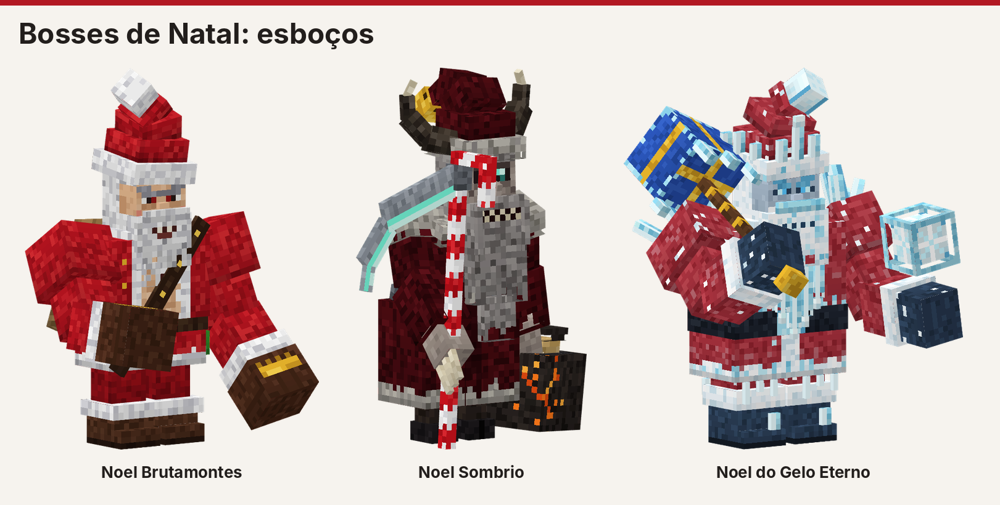

# Bosses de Natal: esboços

Papai Noel chefe para o Natal do TEOF. São esboços: modelo, textura e pose parada, sem animações.

## Noel V-Taper (o escolhido em andamento)


`noel_vtaper`: cerca de 6 blocos de altura (três jogadores), ombros duas vezes mais largos que a cintura, peito nu
com duas cartucheiras em X, óculos escuros, barba e gorro. Atira do quadril com uma metralhadora giratória em cada
mão: seis canos, anéis de bengala doce, caixa de munição verde com a fita de balas caindo. Saco de munição no cinto.
Ossos próprios: `metralhadora_d`, `metralhadora_e` (filhos de `mao_d`/`mao_e`), `saco`.

## Primeira rodada (descartada)



| Boss | Ideia | Altura (escala 1) |
|---|---|---|
| **Noel Brutamontes** (`noel_brutamontes`) | O lutador: casaco aberto, punhos enormes com socos-ingleses de ouro, saco de carvão nas costas, granada-presente no cinto | 4,2 blocos |
| **Noel Sombrio** (`noel_sombrio`) | O corrompido: chifres furando o gorro, olhos que brilham, correntes com sinos, foice de bengala doce, saco de carvão em brasa preso por corrente | 4,6 blocos |
| **Noel do Gelo Eterno** (`noel_gelo_eterno`) | O gigante congelado: coroa de gelo, barba de pingentes, cristais nos ombros, martelo com cabeça de presente congelado, orbe de gelo | 4,4 blocos |

As folhas de cada um (frente, lado, costas e o tamanho ao lado de um jogador) estão em `previas/*_folha.png`.

## Arquivos

* `modelos/<id>.bbmodel`: projeto do Blockbench (formato *Bedrock Entity*, box UV, textura embutida). Abre direto no
  Blockbench (desktop ou web.blockbench.net); conferido no Blockbench web: os três abrem como nas prévias.
* `modelos/<id>.geo.json` + `modelos/<id>.png`: o mesmo modelo exportado para o GeckoLib, o que as exibições do Kunftig
  (`KunftigDisplays`) leem. O `.geo.json` também foi importado no Blockbench e sai igual ao `.bbmodel`.
* `visualizador.html`: os três num visualizador 3D (three.js), para girar no navegador.
* `gerador/`: o código que monta tudo. Os modelos são feitos em Python (`bbtool.py`, um bloco por boss em
  `brutamontes.py`, `sombrio.py`, `gelo.py`) e as prévias são desenhadas com three.js num Chromium headless.

Não havia Blender no ambiente em que foram feitos; o Blockbench é o caminho natural para o GeckoLib, e de lá dá para
exportar `.gltf`/`.obj` para o Blender se precisar.

## Ossos

Os ossos já têm nomes e pivôs pensados para animar depois: `raiz`, `corpo`, `cabeca`, `gorro*`, `braco_d/e`,
`antebraco_d/e`, `punho_d/e` ou `mao_d/e`, `perna_d/e`, e os de cada um (`saco`, `foice`, `lamina*`, `chifre*`,
`capa`, `martelo`, `cabeca_martelo`, `orbe`). `_d` é o lado direito do personagem (+X no Blockbench).

Foram feitos em tamanho de 4 a 5 blocos; no manifesto de exibição dá para aumentar com `"escala"` (API 9).

## Gerar de novo

```bash
cd docs/natal/gerador
npm install three@0.160.0
THREE_ROOT=$PWD python3 gerar.py            # modelos e prévias (todos, ou passe os ids)
python3 folhas.py [ids]                     # folhas de apresentação
python3 pagina.py [ids]                     # visualizador.html (padrão: noel_vtaper)
```

Precisa de Python 3 com numpy e Pillow, Node e Playwright com Chromium.

## A verificar

* No jogo, como exibição do Kunftig: nenhum foi carregado no cliente ainda.
* As partes recortadas (bainha rasgada, gaiola do orbe, pontas da barba) usam transparência por recorte; conferir que
  o desenho das exibições respeita o alfa.
