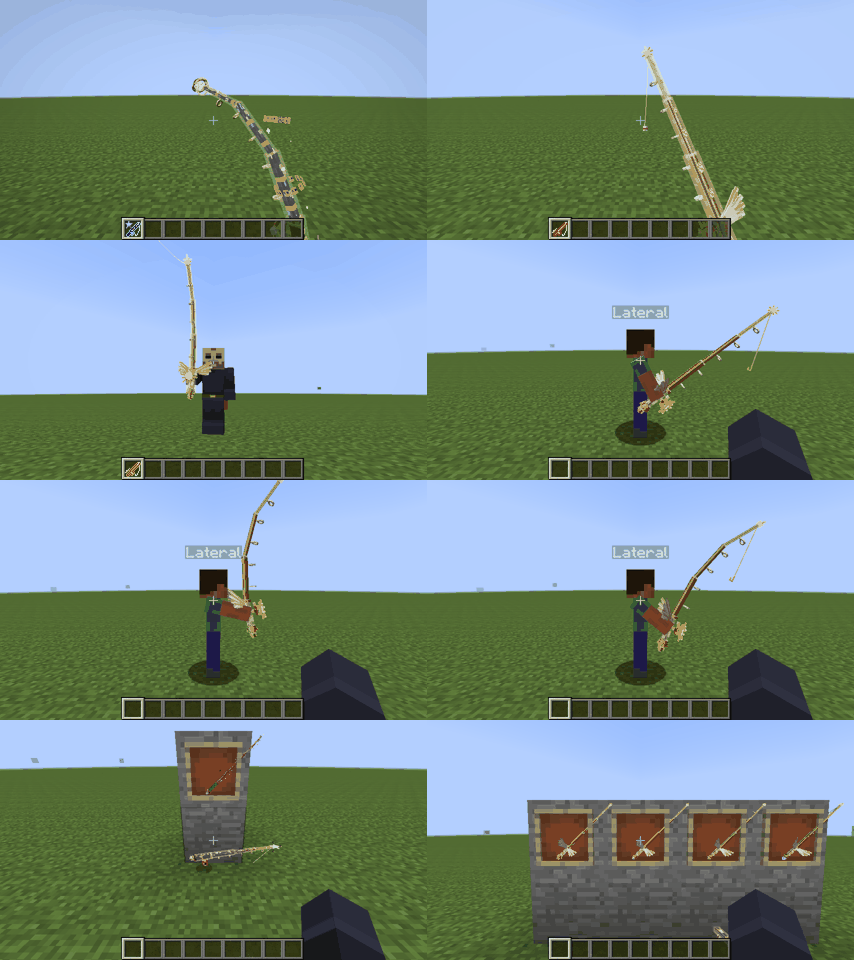

# Varas 3D (GeckoLib)

O Kunftig desenha em 3D, animadas, as varas de pesca que um resource pack declara em
`assets/<namespace>/kunftig/item_models_3d.json` ([issue #13](https://github.com/Akashiic/Kunftig/issues/13)). Os
modelos são Bedrock (geometria 1.12.0, animação 1.8.0), carregados pelo **GeckoLib Unofficial 1.0.4**
(`geckolib-unofficial-1.7.10-1.0.4.jar`, commit `9af9be1`, o do TEOF). O pack das varas é o do AkashicFishing
(`tools/rod3d` lá).

| Onde | O quê |
|---|---|
| Primeira pessoa | modelo animado no lugar do ícone 2D, com o balanço, o equipar e a oscilação do vanilla |
| Terceira pessoa | na mão, seguindo o braço; o braço faz a pose do estado (`animation.braco.<estado>`) |
| Chão e moldura | modelo animado (no chão gira e flutua como qualquer item) |
| Inventário e GUI | o ícone 2D de sempre (mostra a estrela de qualidade) |

Sem GeckoLib, sem o pack, com o modelo quebrado ou com `-Dkunftig.rodModels.disable=true`: o ícone 2D (item models,
[API.md](../API.md) seção 9). Nada quebra.

## Requisitos

* Cliente: Kunftig + GeckoLib Unofficial 1.0.4 (`geckolib3`) + o resource pack.
* Servidor: Kunftig (para `KunftigRods`, API 7) e o plugin chamando a API. Sem isso, o cliente ainda faz `sacar`,
  `lancar` e `parada` sozinho.

## Como funciona

| Peça | Onde | O quê |
|---|---|---|
| Manifesto | `rodmodel/RodModelIndex`, `RodModelDef` | lê os `item_models_3d.json` de todos os packs (recarrega com F3+T e com packs do servidor); separa a chave `kunftig:model` em vara, qualidade, estágio (`.m<k>`) e `.cast` |
| Estados | `rodmodel/RodTimeline` (por jogador) | `sacar` ao trocar para a vara (olhando o item no fim do tick, por causa do Backhand), `lancar` no clique (ou quando a boia aparece, para os outros), `parada` quando a linha volta de um estado em laço; o resto vem do servidor. Vale o evento mais recente; o que não é laço volta a `parada` no fim |
| Protocolo | `rodmodel/RodWire`, canal `kunftig:rod` | `STATE` (entidade, estado, ticks já passados, tensão) e `TENSION`; servidor em `rodmodel/RodStateTracker` + `bukkit/rod/BukkitRodBridge` |
| Desenho | `client/rodmodel/gecko/*` | `IItemRenderer` da vara vanilla, por cima de qualquer outro já registrado (que continua com as varas sem modelo 3D); a mão secundária do Backhand fica com o ícone 2D |
| Posições | `rodmodel/RodDisplays` | desfaz as transformações que o 1.7.10 e o Forge aplicam a um item plano e aplica o `display` do manifesto no referencial das prévias |
| Linha | mixin em `RenderFish` | a linha sai do locator `linha` (capturado no osso `ponta`) na cor de `cor_da_linha` |
| Braço | mixin em `ModelBiped.setRotationAngles` | soma a rotação do braço do estado (o levantar de item do vanilla, −18°, sai: as animações já seguram a vara à frente); com a mão esquerda livre (vanilla e Backhand), também `braco_esquerdo`, e nos estados `duas_maos` o balanço de andar sai dos dois braços para as mãos não largarem a vara. Com a linha fora, o braço é o `braco_com_a_linha` do estado (se houver), e a troca entre as duas poses mistura em `transicao_ticks.vara` quando a linha sai ou volta |
| Balanço | `rodmodel/RodSway` (molas amortecidas, testado) + `RodItemRenderer#sway` | primeira pessoa, só o jogador local: o giro da câmera e o passo (lado, cima) de cada tick puxam molas que dizem quanto a ponta fica para trás (para cima/baixo e para os lados, como a câmera vê), uma para a vara inteira na pega (`pivo`) e uma para a curva (`curva`, mais solta, para a ponta chicotear). O eixo da rotação sai da direção da própria vara no espaço do olho (`direção × lado`), então a ponta anda para o lado na tela qualquer que seja a pose; depois vai ao referencial de cada osso pela matriz do GL e do GeckoLib (espelhado ou não). Soma ao balanço do vanilla, que continua |
| Linha pendurada | `rodmodel/RodPendulum` (testado) + `RodItemRenderer#hang` | um pêndulo por jogador e vista (primeira pessoa ou não): a ponta da linha, levada do espaço do olho ao mundo pela matriz da câmera (lida no `RenderWorldLastEvent`) e pela posição dela; a gravidade e a aceleração da ponta movem a linha; o osso gira para a direção dela antes da animação |
| Graveto | mixin em `RenderPlayer.renderEquippedItems` | com a linha fora, o 1.7.10 desenha um graveto em terceira pessoa; a vara 3D fica (esconde a própria linha pendurada) |

Cuidados com o GeckoLib 1.0.4 (lidos no código do commit `9af9be1`, conferidos no jogo e tratados aqui):

* **O GeckoLib não lê resource packs.** O `GeckoLibCache` só percorre os packs que o FML lista na partida
  (`FMLClientHandler.resourcePackList`: o do vanilla e os dos mods); os packs que o jogador ou o servidor escolhem
  entram depois, no `refreshResources`, e o GeckoLib nunca os vê. Sem tratar isso, `getModel` cai no modelo de teste do
  próprio GeckoLib (`geckolib3:geo/testdiagonal2.geo.json`, uma caixa) e as animações "não existem" (visto no
  harness). O Kunftig lê a geometria e as animações de cada vara pelo `IResourceManager` (que vê todos os packs) e as
  põe no cache do GeckoLib, conferindo a cada desenho, porque cada recarga de recursos cria mapas novos.
* **Os ossos são do modelo em cache, um por arquivo `.geo`**, não por jogador: a pose de cada jogador é guardada e
  reposta (`RodGeoModel`), senão um segundo desenho no mesmo quadro (passada de sombra, outro jogador entre os dois)
  sairia com a pose de outro.
* **Tickers**: o `AnimatedGeoModel` registra um ticker no barramento do FML para cada chave nova e nunca remove. O
  `RodGeoModel` usa o relógio do Kunftig e não registra nenhum; as chaves são poucas (uma por jogador visível,
  reaproveitadas) e nunca o NBT.
* **`ModelFetcher`**: sem um, os controladores do GeckoLib não acham as animações. O Kunftig registra o dele.
* **Locators não existem** nos ossos do 1.0.4: a ponta da linha é a `posicao` de repouso de `ponta_da_linha`
  passada pela matriz do osso `ponta`.
* **Um desenho só por modelo** no `IGeoRenderer`: as passadas (opaca; `luz` com lightmap 240 e sem sombreamento, como
  o `MeshBasicMaterial` das prévias; translúcidas sem escrever profundidade) percorrem a hierarquia inteira e desenham
  só os cubos da passada.
* **Estado de GL**: o GeckoLib tem um cache próprio (`GlStateManager`); o Kunftig repõe o estado do GL depois de
  desenhar e deixa o cache coerente com ele.
* `catmullrom` é linear e degraus são dois keyframes: o pack já vem amostrado; nada a fazer no cliente.
* **Transições** (`transicao_ticks`): o GeckoLib mistura a partir dos *snapshots* dos ossos da chave
  (`rotação − repouso`), copiados no instante da troca. Os giros contínuos (manivela, órbitas, anéis) acumulam voltas;
  antes de cada troca, o Kunftig traz cada snapshot para menos de meia volta do repouso, e a mistura vai pelo caminho
  curto. Quem vê um jogador já no meio de um estado não mistura: entra direto no tempo certo. Nos dois casos o tempo
  da animação é o do estado menos a transição, e os estados que tocam uma vez duram a animação mais a transição. O
  braço mistura do mesmo jeito, a partir da pose do estado anterior.

## O manifesto (`_formato: 1`)

Chave: o modelo do item sem os sufixos (`vara/vara-solar` em `assets/akashicfishing/` é `akashicfishing:vara/vara-solar`;
o item `akashicfishing:vara/vara-solar.ouro.m3.cast` usa esse modelo no estágio 3). Recursos como `namespace:caminho`.

| Campo | Obrigatório | O quê |
|---|---|---|
| `geo`, `animacoes`, `textura` | sim | geometria, animações e textura do estágio 0 |
| `braco` | não | animações dos braços (ossos `braco_direito` e, opcional, `braco_esquerdo`); sem ele, os braços ficam como no vanilla. O esquerdo só se mexe com a mão esquerda livre (sem item do vanilla nem da mão secundária do Backhand) |
| `texturas_mutacao` | não | estágio → textura, ou lista de quadros (troca a cada `ticks_por_quadro`, padrão 3); um estágio sem entrada usa o de baixo |
| `estados` | sim, com `parada` | estado → `vara` (controlador "vara", obrigatório), `aura` (controlador "aura"), `braco`, `braco_com_a_linha` (o braço enquanto a linha está fora; sem ele, `braco`), `laco`, `duas_maos` (`true`: as duas mãos na vara, o balanço de andar sai dos braços; `"com_a_linha"`: só enquanto a linha está fora; padrão `false`) |
| `luz`, `translucido` | não | ossos com brilho máximo / desenhados depois, sem escrever profundidade (por osso, sem herança) |
| `mutacao` | não | estágio → ossos que só aparecem a partir dele (esconder um osso esconde os filhos) |
| `ponta_da_linha` | não | `osso` e `posicao` (repouso, pixels) de onde a linha sai; sem ele, a linha do vanilla |
| `esconder_com_a_linha_na_agua` | não | ossos escondidos com a linha fora (exceto durante `lancar`, que os tira no chicote) |
| `qualidade` | não | qualidade → ossos que só aparecem nela (a pedra no pé do cabo); a do item vem do sufixo, sem sufixo `normal` (também para uma qualidade que a vara não declara) |
| `transicao_ticks` | não | controlador (`vara`, `aura`) → ticks de mistura ao trocar de animação (padrão 0) |
| `cor_da_linha` | não | estágio → `rrggbb`, vale do estágio para cima; sem ele, preta |
| `pega` | não | o ponto do modelo que vai para a mão (pixels) |
| `display` | sim, por contexto | `rotation` (graus, sinais do Bedrock), `translation` (pixels), `scale`, aplicados depois de levar a `pega` à origem |
| `contextos` | não | onde desenhar em 3D (padrão: os de `display`) |
| `linha_pendurada` | não | a linha pendurada na ponta (com a linha recolhida): `osso` (pendurado ao longo do seu -Y) e `comprimento` (pixels do modelo). Vira um pêndulo no mundo: a gravidade a puxa para baixo, ela fica para trás quando a ponta se move e volta ao meio, amortecida. Sem ele, a linha segue o modelo |
| `estados.<s>.ao_atacar` | não | API 11: o estado que um ataque (clique esquerdo do jogador local) começa durante este, na hora, sem esperar o servidor: um nome, ou `{"estado": ..., "de": ticks, "ate": ticks}` para uma janela contada do início do estado (sem `ate`, até o fim). O servidor confirmando o mesmo estado em até 20 ticks não recomeça a animação. Ver [API.md](../API.md), seção 19 |
| `balanco` | não | a inércia em primeira pessoa: `pivo` (o osso que gira na pega, a raiz), `curva` (os ossos que dividem a curvatura, do cabo à ponta) e `forca` (0 a 3, padrão 1). Sem ele, só o balanço do vanilla |

### Modelos que não são varas (peixes)

O mesmo manifesto desenha outros objetos segurados na mão: os peixes do AkashicFishing (`tools/peixe3d` lá). Os campos
acima continuam valendo (estados, braço, `luz`, `translucido`, `qualidade`, `display`, `contextos`, `balanco`...),
mais estes:

| Campo | Obrigatório | O quê |
|---|---|---|
| `itens` | não | os itens (`namespace:nome`) em que o renderer desenha o modelo; padrão `["minecraft:fishing_rod"]`. O Kunftig se põe nesses itens quando o pack é lido, por cima de qualquer renderer que já tenham (que continua com os itens sem modelo 3D) |
| `estados.<s>.modelo` | não | o mesmo que `vara`, para um modelo que não é vara |
| `tamanho` | não | o tamanho vem de um número dos dados do item (`PublicBukkitValues.<chave>`, o PDC do Bukkit): `chave`, `unidades_por_bloco`, `comprimento` (pixels do modelo, de ponta a ponta), `minimo` e `maximo` (blocos) e `padrao` (o valor de um item sem ele). O modelo é desenhado com `valor / unidades_por_bloco` blocos de comprimento, escalado em volta da pega |
| `faixas` | não (precisa de `tamanho`) | faixas de tamanho, da menor para a maior: `ate` (inclusive; a última não tem), `estados` (estado tocado -> estado de `estados`), `display` (substitui o do modelo nos contextos dela) e `pega`. Um peixe grande é segurado com as duas mãos, um gigante acima da cabeça. Trocar para um peixe de outra faixa toca o `sacar` de novo |
| `texturas_qualidade` | não | qualidade -> textura (ou lista de quadros, a cada `ticks_por_quadro`), por cima da textura do estágio; `normal` vale para itens sem sufixo |
| `contextos_estados` | não (só sem `faixas`) | o mundo em volta de quem segura troca estados, como uma faixa: `trovoada`, `chuva`, `neve` ou `noite` -> (estado tocado -> estado de `estados`). O cliente calcula sozinho, sem pacote: chuva caindo nele (céu aberto, bioma de chuva), trovoada, bioma de neve, noite (13000 a 23000 no mundo da superfície). Vale o **primeiro** contexto ativo na ordem do manifesto. Ex.: `"noite": {"parada": "parada_noite"}` |
| `variante` | não | ossos mostrados a partir de um nível de um número guardado no item, lido como o `tamanho` (os dados do item): `chave` (ex.: `akashicfishing:vara-afeto`) e `ossos` (nível -> ossos; a partir do menor nível em que o osso aparece). Sem o valor no item, nível 0. O nome do modelo e o ícone 2D não mudam |

Em terceira pessoa, o 1.7.10 transforma um item plano (o peixe) diferente de um item "3D" que gira em volta (a vara):
`RodDisplays` desfaz a transformação certa para cada um (`Item#isFull3D`, `shouldRotateAroundWhenRendering`), e o
`display` fica no mesmo referencial nos dois casos.

`nome`, `controladores`, `molang` e `quando` são para pessoas e ferramentas, e chaves com `_` são comentários. Outro
campo que o Kunftig não conheça é deixado de lado e listado no log (`... is not read by this Kunftig`); o
`RodPackCheckTest` o acusa como problema. Um modelo com erro
fica de fora (ícone 2D) e o erro vai para o log (`Kunftig 3D rods: ...`) e para `/kunftigclient rods`.

### Referencial do `display`

O mesmo das prévias (`tools/rod3d/previa/render.js` no AkashicFishing): modelo em pixels com X espelhado (como o
GeckoLib e o Blockbench), rotação `Rz(z)·Ry(−y)·Rx(−x)`, translação com X espelhado.

* `primeira_pessoa`: a câmera (o 1.7.10 desenha a mão com campo de visão 70, como as prévias). O balanço, o equipar e
  a oscilação do vanilla continuam; as rotações do golpe saem (as animações da vara substituem).
* `terceira_pessoa`: o ombro direito, Y para cima, mão 10 pixels abaixo (o manequim das prévias), girando com o braço.
* `chao`, `moldura`: a entidade do item, Y para cima.

## Ajuste no jogo

```
/kunftigclient rods                                         estado, quantas varas, problemas no manifesto
/kunftigclient rods state briga 0.8                         toca um estado na sua vara (sem servidor)
/kunftigclient rods display terceira_pessoa                 o display em uso para a vara na mão
/kunftigclient rods display terceira_pessoa 80 0 0 0 0 0 0.6   experimenta um display em todas as varas
/kunftigclient rods display terceira_pessoa reset
```

O display experimentado sai no chat e no log como JSON, pronto para o `DISPLAY` do `tools/rod3d/gerar.py`.

## Testes

* `./gradlew test`: manifesto, sufixos, texturas e cores por estágio, amostragem das animações, máquina de estados,
  protocolo, rastreador do servidor, matrizes do `display` (desfazer o vanilla devolve exatamente o `display`).
* `./gradlew :test -ProdPack=<pasta do pack>`: confere um pack de verdade (todo arquivo, osso e animação citados
  existem). O pack do AkashicFishing (branch `claude/kind-ride-ts9apr`): 8 varas e 34 peixes, nenhum problema.
  O mesmo comando confere as exibições do pack (`kunftig/displays.json`: arquivos, animações dos estados e ossos de
  `itens`, `luz` e `translucido`), pelo `DisplayPackCheckTest`.
* Harness visual (desenvolvimento): com um arquivo `kunftig-rod-harness` em `run/client` e o pack em
  `run/client/resourcepacks`, `./gradlew runClient` abre um mundo plano, segura varas com modelos reais, toca estados,
  lança a linha e salva `screenshots/rods-*.png` de cada contexto (`dev/RodRenderHarness`, fora do jar).

### O que o harness mostrou (Forge 1.7.10 de desenvolvimento, Mesa por software, pack da branch `claude/kind-ride-ts9apr`)



Da esquerda para a direita, de cima para baixo (pack da `claude/kind-ride-ts9apr` em `3731164`, hastes longas):
Akáshica na Ascensão em briga (tensão 1, a vara verga); Solar no estágio 4 com a linha fora, saindo da ponta na cor da
aura; Solar em terceira pessoa em briga, com a linha fora (sem virar graveto); outro jogador de perfil em parada e em
briga; o mesmo 2 ticks depois de passar de briga a captura (a transição no meio); Vara de Coral na moldura e Estrela
Cadente no chão; as quatro qualidades (normal, prata, ouro, irídio), cada uma com a sua pedra no pé do cabo.

* O GeckoLib 1.0.4 monta as 8 geometrias do pack (UV por face, `inflate`, rotação de cubo) e toca as animações, com
  `query.tensao` vergando a vara na briga.
* Primeira pessoa igual à prévia (`vara-solar-primeira-pessoa.gif`, quadro de `parada`): ponta em (0,64; 0,50) da tela
  contra (0,65; 0,49) na prévia.
* Terceira pessoa de perfil (outro jogador) igual à prévia de ação em `parada`, `briga` e `captura`, com o braço.
* **A verificar**: a linha pendurada (`linha_pendurada`) apontando para baixo em F5 e em outro jogador, balançando ao andar
  e ao virar e voltando ao meio.
* **A verificar**: o balanço em primeira pessoa (`balanco`): girar a câmera para a direita deixa a ponta para a
  esquerda e ela volta passando um pouco do meio; olhar para cima ou pular deixa a ponta para baixo; andar de lado
  deixa a ponta para trás e inclina a vara. A linha acompanha a ponta.
* **A verificar**: as duas mãos (`braco_esquerdo`) em `mordida`, `briga` e `recolher`, parado e andando; com um item
  na mão secundária do Backhand, o braço esquerdo fica como no vanilla.
* A linha sai da ponta em primeira e terceira pessoa, na cor do estágio; a linha pendurada some com a boia fora; em
  terceira pessoa a vara não vira graveto.
* Estágio 6 (texturas animadas e coroa), véu translúcido do estágio 4, moldura (diagonal) e chão.
* Uma pedra de qualidade por vara: a do item (normal, prata, ouro, irídio).
* A troca de briga para captura passa por uma pose intermediária, sem salto nem giro de volta.
* Vara sem modelo 3D e cliente sem GeckoLib: exatamente como antes (ícone 2D, graveto, linha preta).

Falta ver no cliente do TEOF, com Angelica, Backhand e NecroTempus, e com vários jogadores (desempenho): ver
[a issue](https://github.com/Akashiic/Kunftig/issues/13).
